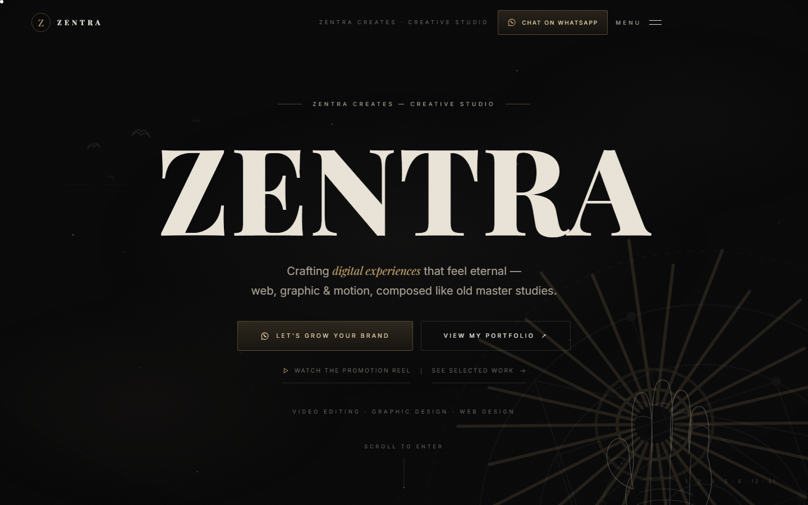

# ZENTRA Creates — Portfolio

<p align="center">
  
</p>

<p align="center">
  <a href="https://zentra.createz.workers.dev"></a>
  
  
  
  
</p>

The studio site for **ZENTRA Creates** — video editing, graphic design, web design and brand growth. Built as a single-page React experience with a dark editorial visual language, project detail pages, transparent pricing and a working contact form.

**Live:** <https://zentra.createz.workers.dev>

<p align="center">
  
</p>

## Features

- Cinematic intro loader, custom cursor, scroll progress and reduced-motion support.
- Hand-composed sections for services, selected work, pricing, process, about and contact.
- Client-side routing with shareable project detail pages.
- Featured showreel and project media served from `public/assets`.
- Contact form handled by a small Cloudflare Worker and delivered through FormSubmit.
- SEO: canonical URL, Open Graph/Twitter cards, `ProfessionalService` structured data.
- Self-hosted fonts and no third-party analytics or tracking scripts.

## Stack

- **React 18** with **Vite 5**
- **react-router-dom** for routes
- **lucide-react** icons
- Hand-written CSS design tokens (`src/styles/tokens.css`, `sections.css`, `main.css`)
- **Cloudflare Workers** static assets + a form handler (`worker.js`)
- No backend database; all content lives in `src/lib/content.js` and `src/data/`

## Getting started

```bash
npm install
npm run dev       # http://127.0.0.1:5173
npm run build     # production build in dist/
npm run preview   # preview the build
```

## Deploying to Cloudflare Workers

The repository includes `wrangler.jsonc` and `worker.js`. The Worker serves the Vite build from `dist/` and handles `POST /` for the contact form.

```bash
npm run build
npx wrangler@latest deploy
```

`wrangler.jsonc` uses `not_found_handling: "single-page-application"`, so client-side routes such as `/work/kegalu-cake-hub` resolve correctly.

The contact form posts to FormSubmit with the address in `worker.js`. Change `CONTACT_EMAIL` there if the studio address changes.

## Project structure

```
index.html                   Vite entry, SEO and structured data
src/
  App.jsx                    page composition and intro loader
  components/                Hero, Services, Projects, ProjectDetail, Pricing, Contact, ...
  data/                      project and pricing data
  lib/content.js             brand, contact details and shared copy
  lib/router.js              small client-side router
  styles/                    tokens, sections and global styles
public/
  assets/projects/           showreel and project media
  assets/images/             brand and editorial imagery
  fonts/                     self-hosted font files
worker.js                    Cloudflare Worker: static assets + contact form
wrangler.jsonc               Workers configuration
```

## Content

All contact details, services, project entries, pricing and copy are in `src/lib/content.js`, `src/data/projects.js` and `src/data/pricing.js`. Update those files and redeploy; no CMS or database is involved.
